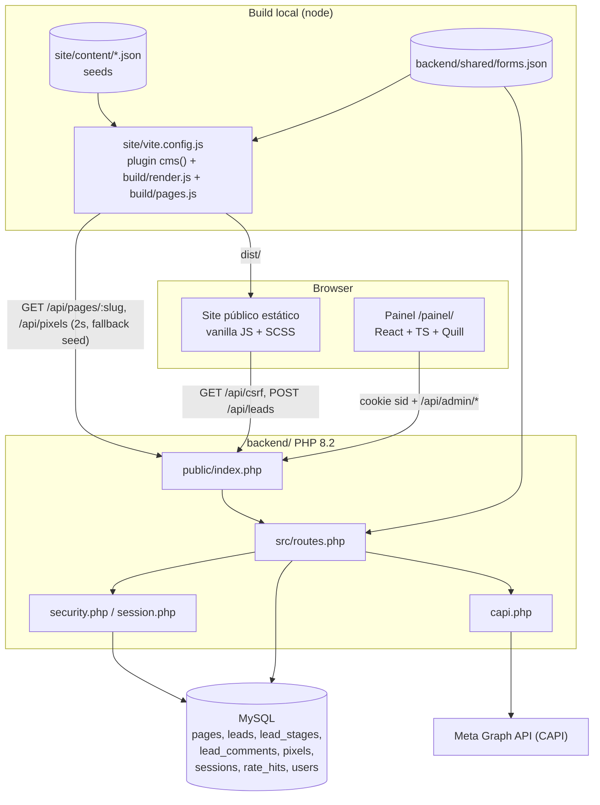
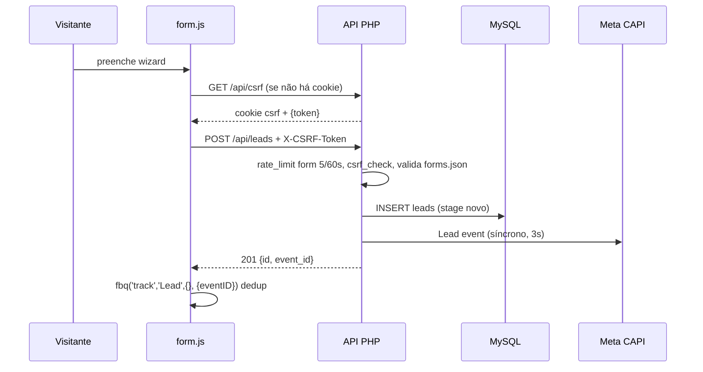
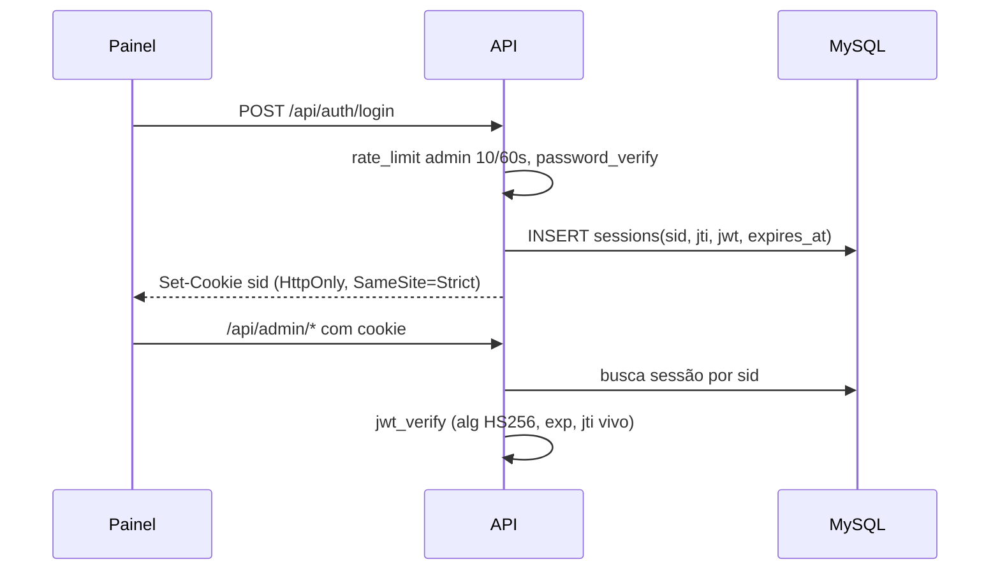
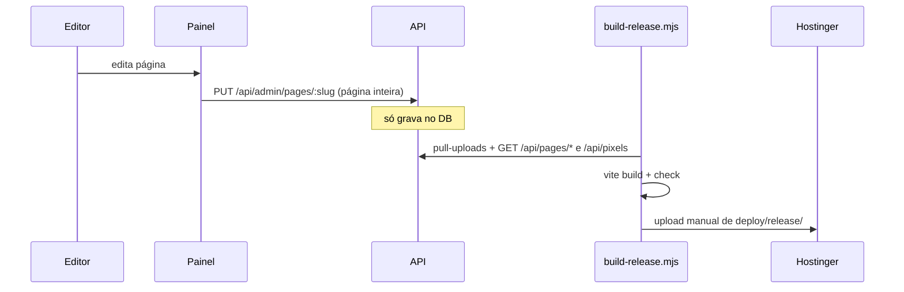

# Codebase Map

> Gerado pelo Cartographer. Último mapeamento: 2026-11-16T11:56:45Z.
> Contagem de tokens não inclui `site/build/` (o scanner pulou essa pasta).

## Visão geral do sistema



Ponto central: o site é **estático, gerado no build**. Edição no painel grava no MySQL; o site só muda após rebuild + re-upload.

## Estrutura de diretórios

```
aylagotelip/
├── admin/                 painel React (hash routing, base './', deploy em public_html/painel/)
│   └── src/               telas .tsx, api.ts, app.css (tema dark único)
├── site/                  site público Vite MPA + SSG próprio
│   ├── */index.html       shells idênticos com placeholders <!--@head--> etc.
│   ├── build/             render.js, pages.js, imgsize.js, check.mjs, sync-cms.js, pull-uploads.mjs
│   ├── content/*.json     seeds de conteúdo por página
│   ├── src/js/            nav, form, modal, blog-filter, pixels
│   ├── src/styles/        _tokens.scss, main.scss, _pages.scss
│   └── public/            fontes woff2, img webp, logo, favicon
├── backend/               API PHP
│   ├── public/index.php   front controller
│   ├── src/               app, http, routes, security, session, validation, capi
│   ├── shared/forms.json  questionários (fonte única site + API)
│   ├── migrations/        001..006 .sql + migrate.php
│   ├── tests/smoke.php    testes com assert, sem framework
│   └── Dockerfile, docker/nginx.conf
├── deploy/                build-release.mjs, api-index.php, htaccess-*, README
├── docker-compose.yml     php + nginx(:8080) + mysql 8.4 (sem Redis)
├── iniciar.mjs            docker compose up + dev de site e admin
├── DESIGN.md              design system (Archivo + Public Sans, #11161b / #ffd000)
└── CLAUDE.md
```

## Guia de módulos

### backend/ (API PHP)

**Entrada**: `backend/public/index.php` (dev) e `deploy/api-index.php` (prod, aponta para `../gotelip-api`). Os dois são cópias mantidas à mão.
**Deps composer**: `firebase/php-jwt ^7.1`, `vlucas/phpdotenv ^5.6`. Usa também `gd` e `curl` (não declarados no composer.json).

| Arquivo | Papel |
|---|---|
| `src/app.php` | `env()` (dotenv lazy), classe `Db` (PDO fino: fetch/all/run), `db()` singleton |
| `src/http.php` | `Http::route/dispatch/body/header/json/fail`, `cors()` por `CORS_ORIGINS`. Primeira rota que casa vence |
| `src/routes.php` | todas as rotas (tabela abaixo) |
| `src/security.php` | headers, `jwt_issue/jwt_verify`, `rate_limit()`, `csrf_check()`, `client_ip()`, log de auditoria JSON |
| `src/session.php` | `session_login`, `session_user`, `require_auth()` (401 + exit) |
| `src/validation.php` | `forms_schema()`, `form_answers_check`, slug, imagens WebP, `GALLERY_SLOTS`, `uploads_*` |
| `src/capi.php` | `capi_send_lead()` Meta Conversions API, síncrono, timeout 3s |
| `migrations/migrate.php` | runner idempotente (`schema_migrations`), split ingênuo por `;`, seed admin se `SEED_ADMIN_PASS` >= 12 chars |
| `tests/smoke.php` | uuid4, JWT `alg=none`, IP truncado, slug, CAPI hash, forms schema. Não cobre rotas, CSRF nem rate limit |

#### Rotas

| Método | Caminho | Auth | Função |
|---|---|---|---|
| GET | /api/health | não | `{ok:true}` |
| GET | /api/csrf | não | emite cookie `csrf` + token |
| POST | /api/leads | CSRF + 5/min por IP | lead público validado por forms.json; CAPI; 201 `{id,event_id}` |
| POST | /api/auth/login | 10/min por IP | cria sessão, cookie `sid` |
| POST | /api/auth/logout | não | apaga sessão |
| GET | /api/auth/me | sessão | usuário atual |
| GET/POST | /api/admin/leads | sessão | lista / lead manual (`channel=painel`) |
| PATCH | /api/admin/leads/{id} | sessão | stage, deadline, next_action, estimated_value, campos base |
| GET/POST | /api/admin/leads/{id}/comments | sessão | comentários |
| PATCH/DELETE | /api/admin/comments/{id} | sessão + autor | editar / excluir |
| POST | /api/admin/uploads | sessão | imagem para WebP, máx 8MB, JPEG/PNG/WebP |
| GET | /api/admin/gallery | sessão | biblioteca com `em_uso` |
| POST | /api/admin/gallery/{slot} | sessão | variantes por `GALLERY_SLOTS` |
| DELETE | /api/admin/gallery/{nome} | sessão | 409 se em uso |
| GET | /api/pixels | não | pixels ativos (sem token) |
| GET | /api/admin/pixels | sessão | token mascarado |
| PUT | /api/admin/pixels/{provider} | sessão | `meta` ou `ga4`; token vazio mantém o anterior |
| DELETE | /api/admin/pixels/{provider}/token | sessão | limpa token CAPI |
| GET | /api/pages/{slug} | não | página (blocks + meta) |
| PUT | /api/admin/pages/{slug} | sessão | upsert da página inteira |
| GET/POST | /api/admin/stages | sessão | etapas do funil |
| PATCH/DELETE | /api/admin/stages/{id} | sessão | `novo/ganho/perdido` travadas; DELETE com leads exige `?move_to=slug` |

#### Schema (após 001..006). PKs CHAR(36) UUIDv4, exceto `sessions.id` CHAR(64)

- **users**: email único, password_hash bcrypt 12, name, role (`admin`).
- **pages**: slug único, title, blocks JSON, meta JSON. É o CMS: projetos, posts e serviços vivem em `blocks`.
- **leads**: name_company, email, phone, channel, form, enterprise, demand, city, notes, answers JSON, stage (slug, sem FK), deadline, next_action, estimated_value DECIMAL(12,2).
- **lead_stages**: slug, label, color, position, locked. Seed: novo 10, qualificacao 20, diagnostico 30, proposta 40, follow_up 50, ganho 90, perdido 99.
- **lead_comments**: lead_id (FK CASCADE), user_id (FK SET NULL), author_name, body, edited_at.
- **pixels**: provider único, pixel_id, capi_token, enabled.
- **sessions**: id (sid), user_id, jti, jwt, expires_at.
- **rate_hits**: bucket, ident, hit_at DATETIME(3).
- Tabelas `projects` e `posts` foram removidas na 002.

### admin/ (painel)

**Entrada**: `src/main.tsx` para `src/App.tsx`.
**Stack**: React 18, Vite 5, TS strict (`noUnusedLocals` quebra o build), Quill 2. Sem router, sem store global.

| Arquivo | Papel |
|---|---|
| `api.ts` | `api<T>()` com `credentials:'include'`, envia `X-CSRF-Token` do cookie `csrf`, lança `ApiError(status, code)`. Tipos `Lead`, `Stage`, `Page`, `User`, `Comment` |
| `App.tsx` | shell, `/api/auth/me`, `useHash` router, array `NAV`, cadeia de rotas; rota desconhecida cai no Kanban |
| `Login.tsx` | login; `rate_limited` com mensagem própria |
| `PageHead.tsx` | cabeçalho padrão de toda tela |
| `FormKit.tsx` | `Grupo`, `Campo`, `CampoLongo`, `useEscape` |
| `PageEditor.tsx` | editor JSON genérico (`Field`, `blank`, helpers de data/slug/categoria) |
| `labels.ts` | rótulos e dicas por nome de campo JSON |
| `Collection.tsx` | lista + editor de um bloco array de uma página CMS (busca, 8 por página, reordenar) |
| `Editor.tsx` | Quill; upload via `/api/admin/uploads`; `src` relativo `/uploads/...`; remove `data:` |
| `Projeto.tsx`, `Faq.tsx` | editores custom para Collection |
| `Company.tsx` | bloco `contact` da página `contato` (alimenta o rodapé de todo o site) |
| `Galeria.tsx` | biblioteca de imagens + slots nas páginas home/servicos/sobre |
| `Kanban.tsx` | CRM: pipeline / lista / métricas, drag com PATCH otimista + rollback, drawer `Detail` |
| `Comentarios.tsx` | thread de comentários por lead |
| `Etapas.tsx` | CRUD de etapas, reordenar por troca de `position`, paleta |
| `Pixels.tsx` | Meta e GA4, token CAPI |
| `icons.tsx` | `Icon` + paths SVG 16x16 |
| `app.css` | tema dark único (`--bg #0a0d10`, `--gold #ffd000`, `--s1..--s8`) |

Rotas do painel: `/leads` (padrão), `/artigos` (Collection blog/posts), `/projetos` (Collection projetos/slots + Projeto), `/faq` (Collection sobre/faq + Faq), `/galeria`, `/etapas`, `/empresa`, `/pixels`.

### site/ (público)

**Entrada**: `site/vite.config.js` (build) e `src/main.js` (runtime: `initNav, initForm, initModal, initBlogFilter, initPixels`).
**Deps**: só `vite` e `sass`.

| Arquivo | Papel |
|---|---|
| `vite.config.js` | plugin `cms()` troca placeholders; `PAGES`; `collectionRoutes()` gera `blog/<slug>/` e `servicos/<slug>/`; `cacheBust()`; `uploads()` copia `backend/public/uploads` para `dist/uploads` |
| `build/render.js` | `header`, `footer`, `pageHead`, `jsonLd`, `adaptiveForm`, `directContactForm`, `BRANCHES`, `BRANCH_MAP`, `FORMS` (lê forms.json) |
| `build/pages.js` | renderer por página + JSON-LD (article, service, faq) |
| `build/imgsize.js` | lê header WebP para `width/height` (só `/uploads/` e `/img/` locais) |
| `build/check.mjs` | asserts pós-build em `dist/` |
| `build/sync-cms.js` | empurra seeds para o DB (`CMS_EMAIL`, `CMS_PASS`) |
| `build/pull-uploads.mjs` | baixa `/uploads/*.webp` citados no CMS |
| `content/*.json` | seeds `{title, meta, blocks}`; definem o formato que a API pode sobrescrever |
| `src/js/form.js` | wizard adaptativo de 4 passos, máscara de telefone, CSRF, POST lead, `fbq Lead` com `eventID` |
| `src/js/pixels.js` | carrega Meta/GA4 após 3s ou primeira interação |
| `src/js/modal.js` | `<dialog>` de projeto, dados de `#projetos-data`, deep-link por hash |
| `src/js/blog-filter.js` | busca no blog; exports puros usados pelo `check.mjs` |
| `src/js/nav.js` | menu mobile |
| `src/styles/_tokens.scss` | tokens (`--brand-900 #0a0d10`, `--gold #ffd000`, Archivo/Public Sans) |

### deploy/

`VITE_API_URL=https://dominio node deploy/build-release.mjs` (opcional `CMS_URL=none` para usar seeds). Gera `deploy/release/`:
- `public_html/`: `site/dist`, `painel/` (admin), `uploads/` vazio, `api/index.php` + `api/.htaccess`, `.htaccess` raiz.
- `gotelip-api/`: `src`, `vendor`, `migrations`, `shared`, `.env.example`. Fica um nível acima de `public_html`.
- `.env` real é criado no servidor. Migrations importadas à mão no phpMyAdmin.

## Fluxos de dados

### Captação de lead



### Login do painel (BFF)



### Publicação de conteúdo



## Convenções

- Identificadores e comentários em pt-BR (comentários PHP sem acento). Notas `ponytail:` / `shortcut:` marcam atalhos conhecidos.
- PKs sempre UUIDv4. Erros da API são códigos (`rate_limited`, `telefone_invalido`, `etapa_com_leads:N`) traduzidos na UI.
- Admin: estado local `useState`, erros inline (nunca `alert`), salvar página inteira (last-write-wins).
- Site: HTML gerado no build, JS só para comportamento, BEM em SCSS, imagens com `width/height`.
- `forms.json` é a fonte única dos questionários (site + API).

## Gotchas

1. **CLAUDE.md desatualizado em pontos de arquitetura**: não existe Redis nem Lua. Sessões, allowlist de `jti` e rate limit ficam no MySQL (migration 004). Cores e fontes atuais estão em DESIGN.md (`#11161b`, Archivo/Public Sans). Etapas do Kanban são editáveis (tabela `lead_stages`). Não há tabelas `projects`/`posts`.
2. **CSRF só em `POST /api/leads`**. Rotas `/api/admin/*` e login dependem de SameSite=Strict + CORS.
3. **Ownership só em comentários**. Qualquer usuário logado faz o resto; `role` nunca é checado.
4. **Sessão dura 15 min** (`SESSION_TTL=900`) sem refresh.
5. **Edição no painel não vai ao ar** até rebuild + re-upload. Mensagens "Publicado no site" significam "salvo no DB".
6. **Build cai em seed silenciosamente** se a API não responde em 2s (log `[cms:<key>] seed local`).
7. **Bloco da API com formato diferente do seed é ignorado** (array/objeto/string). Bloco novo exige atualizar o seed antes.
8. **`VITE_API_URL` é build-time** nos dois apps; sem ele o bundle de prod aponta para `localhost:8080`.
9. **Slug derivado do título** no editor: renomear quebra URL.
10. **WhatsApp `553391456937` fixo** em `modal.js` e mensagens do `form.js`, fora do bloco `contato`.
11. **Mapas branch para serviço duplicados** em `render.js` e `form.js`.
12. **`pull-uploads.mjs` não lista `orcamento`**.
13. **`form` desconhecido em POST /api/leads** é gravado e `answers` passa sem validação.
14. **`estimated_value` e `deadline`** sem validação no PATCH: valor ruim vira 500.
15. **`uploads_gc()` é código morto**: uploads órfãos nunca são limpos.
16. **nginx local sem `client_max_body_size`**: upload acima de 1MB dá 413 em dev.
17. **`client_ip()` usa só `REMOTE_ADDR`**: atrás de proxy/CDN o rate limit vira por proxy.
18. **CAPI síncrono**: até 3s a mais por lead. GA4 não tem envio server-side.
19. **`deploy/api-index.php` duplica `backend/public/index.php`**: manter os dois em sincronia.
20. `migrate.php` divide SQL por `;`: não usar `;` dentro de literais.

## Guia de navegação

**Nova rota de API**: `backend/src/routes.php` (+ helpers em `validation.php`); migração nova em `backend/migrations/00N_*.sql`; teste em `tests/smoke.php`.
**Nova tela do painel**: `admin/src/<Nome>.tsx` com `PageHead` + `api()`; entrada em `NAV` e na cadeia de rotas de `App.tsx`; ícone em `icons.tsx`; rótulos em `labels.ts`; estilos em `app.css`. Lista dentro de página CMS: reusar `Collection` com `editor` custom.
**Nova página do site**: `site/<slug>/index.html` (copiar shell), `site/content/<slug>.json`, renderer em `build/pages.js`, entrada em `PAGES` do `vite.config.js`, link em `header()/footer()` de `render.js`, slug em `sync-cms.js` e `pull-uploads.mjs`, assert em `check.mjs`.
**Novo campo de questionário**: `backend/shared/forms.json`; se afeta `enterprise/demand`, `payload()` em `form.js` + `BRANCHES/BRANCH_MAP` em `render.js`.
**Novo campo no formulário direto**: `directContactForm()` em `render.js`, validação em `routes.php`/`validation.php`, tipo `Lead` em `admin/src/api.ts`, `Detail` em `Kanban.tsx`, migração se coluna nova.
**Novo provedor de pixel**: `PROVIDERS` em `Pixels.tsx`, `LOADERS` em `pixels.js`, validação de provider em `routes.php`.
**Mexer em auth**: `backend/src/session.php`, `security.php` (`jwt_*`, `rate_limit`, `csrf_check`), rotas `/api/auth/*`.
**Deploy**: `deploy/build-release.mjs` e `deploy/README.md`.

## Dev local

1. `cp backend/.env.example backend/.env`
2. `docker compose up -d`, depois `docker compose exec php composer install` e `docker compose exec php php migrations/migrate.php`
3. `npm run iniciar` (API :8080, admin :5173, site :5174)
4. Testes: `docker compose exec php php tests/smoke.php`; pós-build do site: `cd site && npm run check`
